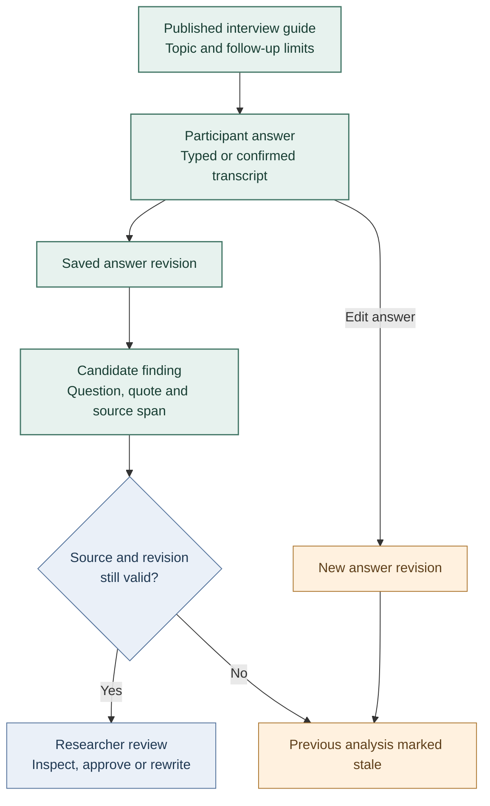
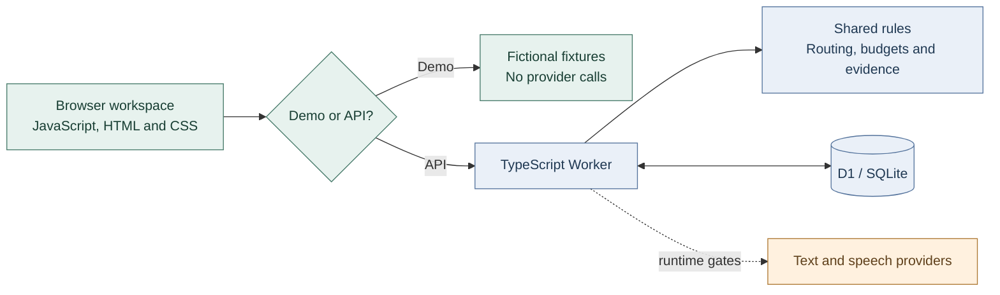

<div align="center">

# Playlogue

### Read the finding. Check the player's words.


**English | [简体中文](README.zh-CN.md)**

[Source code](client/) · [Development notes](docs/DEVELOPMENT.md) · [Screenshot provenance](docs/SCREENSHOTS.md)

</div>


*Actual interface with hand-authored fictional records.*

An interview answer changes. What happens to the analysis that quoted it?

Playlogue keeps that connection explicit. Each candidate finding points to the question, the exact answer span and the revision it used. Edit the answer and the old analysis becomes stale. A researcher can inspect the source before accepting or rewriting the finding.

The prototype also runs guided player interviews, with limits on follow-ups and model-call budgets. Participants answer one question at a time, type a reply or confirm a voice transcript, and can pause or revise their answers.

## How evidence moves through the workspace



| Design decision | What happens in practice |
| --- | --- |
| Put a limit on follow-ups | The current API gameplay guide asks three main questions, allows at most one immediate follow-up per topic and two overall. Saved guides keep their own limits. |
| Store the evidence with the finding | Source references include question and answer IDs, answer revision, UTF-16 offsets and a verbatim quote. |
| Treat an edit as a new source | Answer and session revisions change. Earlier analyses lose their current-source status. |
| Make voice submission deliberate | Participants review and confirm a transcript before it becomes an answer. |
| Keep retry and spending rules on the server | State checks, duplicate-request protection and budget reservations constrain API operations. |

A valid citation confirms where the words came from. It doesn't establish that the interpretation is correct. Researchers still review candidate findings.

## Try the fictional practice

Use **Node.js 24+**. The API test harness uses Node's built-in SQLite.

```sh
git clone https://github.com/cloviszhu/Playlogue.git
cd Playlogue
npm ci
npm start
```

Open [127.0.0.1:4174](http://127.0.0.1:4174). The local practice uses fictional answers and doesn't call an AI or audio provider. No API key is needed. Its older practice guide has different limits from the current API gameplay guide.


<details>
<summary><strong>Architecture and code worth reading</strong></summary>



The frontend uses JavaScript ES modules. The Worker uses TypeScript; shared JavaScript modules define interview transitions, source validation and budgets. Drizzle defines the schema, and esbuild bundles the Worker.

| Source | Focus |
| --- | --- |
| [client/adapter.js](client/adapter.js) | Demo and API boundaries |
| [shared/evidence.mjs](shared/evidence.mjs) | Exact spans, source manifests and stale analysis |
| [shared/default-guide.mjs](shared/default-guide.mjs) | Built-in guides and versioned question limits |
| [shared/budget.mjs](shared/budget.mjs) | Call reservations and spending accounting |
| [server/repository.ts](server/repository.ts) | Persisted session changes and revision checks |
| [db/schema.ts](db/schema.ts) | Database schema |

Span repair is narrow: the verbatim quote must occur exactly once in its named answer, and the repaired span must pass the same strict validation. A plausible paraphrase doesn't qualify.

</details>

<details>
<summary><strong>Build commands, runtime setup and verification status</strong></summary>

```sh
npm run check
npm run build
npm run typecheck
npm run test:synthetic
```

These are verification commands, not a claim that the suite passes. [Development notes](docs/DEVELOPMENT.md) record the failed full-suite attempt and a narrower 44-test pass. Date-bound fixtures and the fixed server call cutoff affect current results.

After building, `npm run preview:worker` starts a local API preview with fresh synthetic SQLite data. Open [127.0.0.1:4175/?adapter=api](http://127.0.0.1:4175/?adapter=api). Live calls and trusted identity remain disabled.

Hosted use needs private runtime bindings, including `DB`, `APP_ORIGIN`, `AUTH_MODE`, `SITE_ACCESS_MODE` and `RESEARCHER_USER_ID`, plus provider credentials where required. The server checks authorization, consent, quotas, retention and call budgets. The call window in `shared/session.mjs` ends at `2026-10-04T16:00:00Z`; configuring credentials alone won't make live calls available.

Synthetic tests don't verify microphone/speaker behavior, continuous voice, provider billing or research quality. App-side deletion and provider retention have separate boundaries. This repository doesn't publish a hosted demo or grant a new open-source license.

</details>

For a wider view, open the [full fictional evidence example](docs/images/evidence.png). [Screenshot notes](docs/SCREENSHOTS.md) identify the capture source and explain the fixture data.
