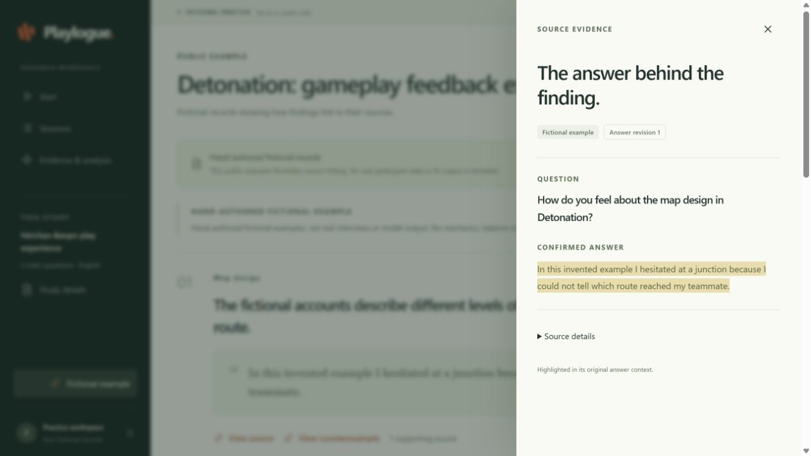
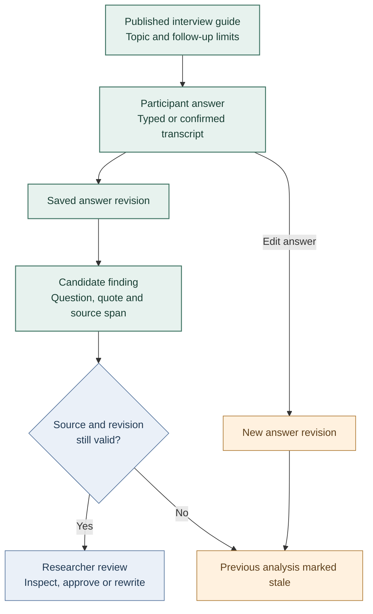
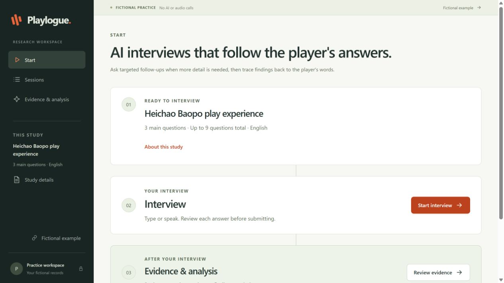
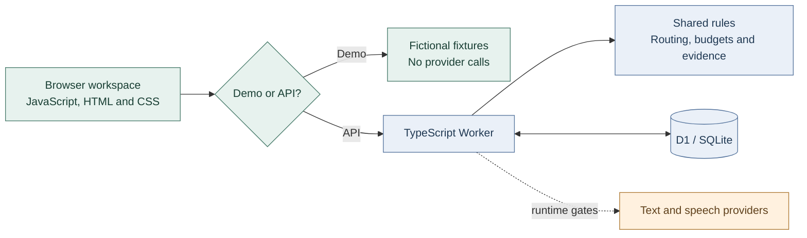
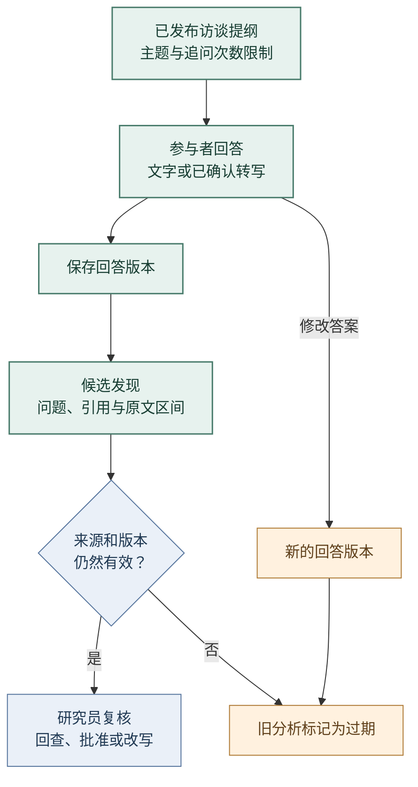
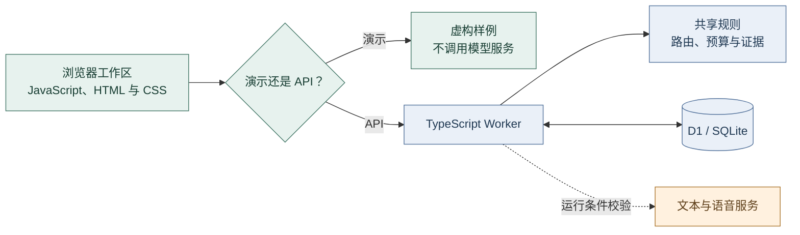

<div align="center">

# Playlogue

### Read the finding. Check the player's words.
从玩家回答出发，让每条发现都有原文可查。


**[English](#english) | [简体中文](#简体中文)**

[Source code](client/) · [Development notes](docs/DEVELOPMENT.md) · [Screenshot provenance](docs/SCREENSHOTS.md)

</div>



*Actual interface with hand-authored fictional records. / 真实界面截图，内容为人工编写的虚构记录。*

## English

An interview answer changes. What happens to the analysis that quoted it?

Playlogue keeps that connection explicit. Each candidate finding points to the question, the exact answer span and the revision it used. Edit the answer and the old analysis becomes stale. A researcher can inspect the source before accepting or rewriting the finding.

The prototype also runs guided player interviews, with limits on follow-ups and model-call budgets. Participants answer one question at a time, type a reply or confirm a voice transcript, and can pause or revise their answers.

### How evidence moves through the workspace



| Design decision | What happens in practice |
| --- | --- |
| Put a limit on follow-ups | The current API gameplay guide asks three main questions, allows at most one immediate follow-up per topic and two overall. Saved guides keep their own limits. |
| Store the evidence with the finding | Source references include question and answer IDs, answer revision, UTF-16 offsets and a verbatim quote. |
| Treat an edit as a new source | Answer and session revisions change. Earlier analyses lose their current-source status. |
| Make voice submission deliberate | Participants review and confirm a transcript before it becomes an answer. |
| Keep retry and spending rules on the server | State checks, duplicate-request protection and budget reservations constrain API operations. |

A valid citation confirms where the words came from. It doesn't establish that the interpretation is correct. Researchers still review candidate findings.

### Try the fictional practice

Use **Node.js 24+**. The API test harness uses Node's built-in SQLite.

```sh
git clone https://github.com/cloviszhu/Playlogue.git
cd Playlogue
npm ci
npm start
```

Open [127.0.0.1:4174](http://127.0.0.1:4174). The local practice uses fictional answers and doesn't call an AI or audio provider. No API key is needed. Its older practice guide has different limits from the current API gameplay guide.



<details>
<summary><strong>Architecture and code worth reading</strong></summary>



The frontend uses JavaScript ES modules. The Worker uses TypeScript; shared JavaScript modules define interview transitions, source validation and budgets. Drizzle defines the schema, and esbuild bundles the Worker.

| Source | Focus |
| --- | --- |
| [client/adapter.js](client/adapter.js) | Demo and API boundaries |
| [shared/evidence.mjs](shared/evidence.mjs) | Exact spans, source manifests and stale analysis |
| [shared/default-guide.mjs](shared/default-guide.mjs) | Built-in guides and versioned question limits |
| [shared/budget.mjs](shared/budget.mjs) | Call reservations and spending accounting |
| [server/repository.ts](server/repository.ts) | Persisted session changes and revision checks |
| [db/schema.ts](db/schema.ts) | Database schema |

Span repair is narrow: the verbatim quote must occur exactly once in its named answer, and the repaired span must pass the same strict validation. A plausible paraphrase doesn't qualify.

</details>

<details>
<summary><strong>Build commands, runtime setup and verification status</strong></summary>

```sh
npm run check
npm run build
npm run typecheck
npm run test:synthetic
```

These are verification commands, not a claim that the suite passes. [Development notes](docs/DEVELOPMENT.md) record the failed full-suite attempt and a narrower 44-test pass. Date-bound fixtures and the fixed server call cutoff affect current results.

After building, `npm run preview:worker` starts a local API preview with fresh synthetic SQLite data. Open [127.0.0.1:4175/?adapter=api](http://127.0.0.1:4175/?adapter=api). Live calls and trusted identity remain disabled.

Hosted use needs private runtime bindings, including `DB`, `APP_ORIGIN`, `AUTH_MODE`, `SITE_ACCESS_MODE` and `RESEARCHER_USER_ID`, plus provider credentials where required. The server checks authorization, consent, quotas, retention and call budgets. The call window in `shared/session.mjs` ends at `2026-10-04T16:00:00Z`; configuring credentials alone won't make live calls available.

Synthetic tests don't verify microphone/speaker behavior, continuous voice, provider billing or research quality. App-side deletion and provider retention have separate boundaries. This repository doesn't publish a hosted demo or grant a new open-source license.

</details>

For a wider view, open the [full fictional evidence example](docs/images/evidence.png). [Screenshot notes](docs/SCREENSHOTS.md) identify the capture source and explain the fixture data.

[Read in 简体中文](#简体中文)

---

## 简体中文

玩家改了回答，引用旧回答的分析该怎么办？

Playlogue 把这层关系明确记录下来。每条候选发现都关联实际问题、原文片段和回答版本。回答一旦修订，旧分析就被标记为过期。研究员可以先回查依据，再决定批准还是改写这条发现。

原型也支持引导式玩家访谈，限制追问次数与模型调用预算。参与者逐题作答，可以输入文字，也可以确认语音转写；过程中支持暂停与修改答案。

### 一条回答如何成为可复核的证据



| 设计选择 | 具体行为 |
| --- | --- |
| 给追问设置上限 | 当前 API 玩法提纲有三个主问题，每个主题最多一个即时追问，全程最多两个。已保存提纲沿用各自的限制。 |
| 把引用依据和发现一起保存 | 来源记录包含问题与回答 ID、回答版本、UTF-16 区间及逐字引用。 |
| 将答案修改视为来源变化 | 更新回答与会话版本，使旧分析不再作为当前版本的分析使用。 |
| 明确确认语音内容 | 参与者查看并确认转写后，内容才成为正式回答。 |
| 在服务端控制重试与支出 | 通过状态检查、重复请求保护和预算预留约束 API 操作。 |

引用有效，只能证明这些话来自哪里。研究员仍需判断解释是否成立。

### 体验虚构访谈

使用 **Node.js 24+**。API 测试工具依赖 Node 内置 SQLite。

```sh
git clone https://github.com/cloviszhu/Playlogue.git
cd Playlogue
npm ci
npm start
```

打开 [127.0.0.1:4174](http://127.0.0.1:4174)。本地练习使用虚构回答，不调用 AI 或音频服务，也不需要 API key。练习使用较早的提纲，其次数限制与当前 API 玩法提纲不同。

<details>
<summary><strong>架构与源码入口</strong></summary>



前端使用 JavaScript ES modules，Worker 使用 TypeScript。共享 JavaScript 模块定义访谈状态转换、引用校验与预算规则；Drizzle 定义数据结构，esbuild 完成 Worker 打包。

| 源码 | 阅读重点 |
| --- | --- |
| [client/adapter.js](client/adapter.js) | 演示与 API 的边界 |
| [shared/evidence.mjs](shared/evidence.mjs) | 原文区间、来源快照和旧分析失效 |
| [shared/default-guide.mjs](shared/default-guide.mjs) | 内置提纲、版本与问题上限 |
| [shared/budget.mjs](shared/budget.mjs) | 调用预算预留与费用记录 |
| [server/repository.ts](server/repository.ts) | 会话持久化与版本检查 |
| [db/schema.ts](db/schema.ts) | 数据库结构 |

引用偏移只在很窄的条件下修复：逐字引用必须在指定回答中唯一出现，修复后的区间还要通过原有严格校验。意思相近的改写不符合要求。

</details>

<details>
<summary><strong>构建命令、运行配置与验证状态</strong></summary>

```sh
npm run check
npm run build
npm run typecheck
npm run test:synthetic
```

这些是核验命令，不代表测试全部通过。[开发记录](docs/DEVELOPMENT.zh-CN.md)保留了全量测试失败及较小范围 44 项测试通过的结果。固定日期样例和服务端调用截止时间会影响当前运行结果。

构建后运行 `npm run preview:worker`，再打开 [127.0.0.1:4175/?adapter=api](http://127.0.0.1:4175/?adapter=api)。该预览使用全新的合成 SQLite 数据，关闭真实调用与可信身份。

托管运行需要私下配置 `DB`、`APP_ORIGIN`、`AUTH_MODE`、`SITE_ACCESS_MODE`、`RESEARCHER_USER_ID` 等绑定，以及所需的服务凭证。服务端检查授权、同意、额度、保留期和调用预算。`shared/session.mjs` 中的调用窗口止于 `2026-10-04T16:00:00Z`，仅填写凭证不会开放真实调用。

合成测试没有验证麦克风与扬声器、连续语音、真实账单或研究质量。应用侧删除与服务提供方的数据保留也有不同边界。仓库不提供公开托管演示，也不额外授予新的开源许可证。

</details>

[完整虚构证据示例](docs/images/evidence.png)展示了更多分析内容。[截图说明](docs/SCREENSHOTS.md)记录了截图来源和样例性质；图中的发现由人工编写，不是真实参与者数据或模型研究结果。

[Back to English](#english)
