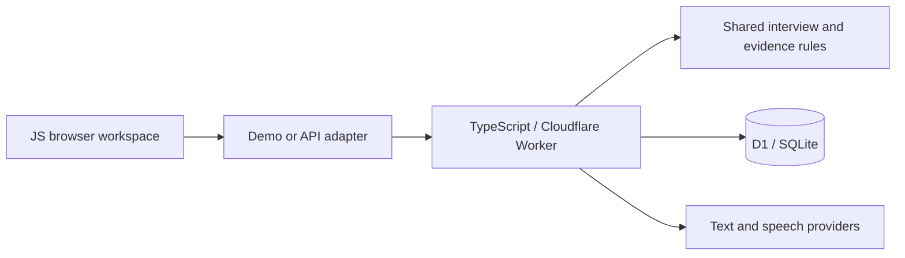

# Playlogue

[English](README.md) · [简体中文](README.zh-CN.md)

**Game UX interviews, with findings you can trace back to the player's words.**

Playlogue is a research workspace prototype that connects guided player interviews to evidence review. Players answer one question at a time; researchers inspect candidate findings alongside the exact question, quote and answer revision behind them.

**Guided interviews · Bounded follow-ups · Traceable evidence · Text & voice flows**


*Actual local interface with hand-authored fictional records. No participant data or model-generated research results are pictured.*

## The experience

1. **Prepare a study.** Use the built-in gameplay feedback guide or define a custom study with a research goal and question limits.
2. **Listen and follow up.** Review each typed answer or confirm a voice transcript before submission. Follow-ups stay within the published guide's topic and question budget.
3. **Review the evidence.** Inspect transcripts, supporting quotes, counterexamples and unknowns before confirming a candidate finding.


## Design highlights

| Decision | Why it matters |
| --- | --- |
| Controlled follow-ups | The current built-in gameplay guide covers map design, perceived operator balance, and customization/purchasing economy: three main questions, at most one immediate follow-up per topic and two overall. Saved guides keep their own version and limits. |
| Exact-source findings | Findings carry question/answer IDs, answer revision, UTF-16 span offsets and a verbatim quote. Validation checks that the quote matches its source before it can be used as evidence. |
| Revision-aware review | Editing an answer changes its revision and the session's content/evidence revisions. Analyses based on the previous snapshot become stale; old quotes cannot silently support the edited answer. |
| Deliberate text/voice interaction | Voice uses question playback, recording, transcription and explicit transcript confirmation. Mode changes and interrupted tasks are handled through session state. |

The local practice uses an older fictional guide with its own limits and disables AI/audio calls. Hosted voice requires configured services and an unexpired server call window; microphone, speaker and continuous-voice acceptance are not established by synthetic tests. Candidate findings remain hypotheses for human review.

## Architecture & stack



| Layer | Implementation |
| --- | --- |
| Interface | JavaScript ES modules, HTML/CSS; interview, transcript and evidence views in [client/](client/) |
| State & evidence | Shared JavaScript modules for routing, question budgets, revisions and source validation in [shared/](shared/) |
| API & persistence | TypeScript Worker, D1 repository; Drizzle ORM schema and generated SQLite migrations in [server/](server/), [db/](db/) and [drizzle/](drizzle/) |
| Build & verification | esbuild bundles the Worker; TypeScript checks and Node's built-in test runner exercise synthetic workflows |

## Run locally

Use **Node.js 24+** (the API test harness uses built-in SQLite).

```sh
npm ci
npm start
```

Open **http://127.0.0.1:4174** to explore the fictional practice and source-linked example without an API key. The example is a UI demonstration, not a live interview service.

```sh
npm run check
npm run build
npm run typecheck
npm run test:synthetic
```

For the local Worker/API preview, run `npm run preview:worker` after building, then open `http://127.0.0.1:4175/?adapter=api`. This uses a fresh synthetic SQLite database with live calls and trusted identity disabled.

## Explore further

- [Full fictional evidence example](docs/images/evidence.png)
- [Runtime configuration & validation boundaries](docs/DEVELOPMENT.md) · [中文版](docs/DEVELOPMENT.zh-CN.md)
- [Screenshot provenance](docs/SCREENSHOTS.md)

This repository presents an engineering prototype. Hosted use requires private runtime configuration; no public demo or deployment is claimed here.
