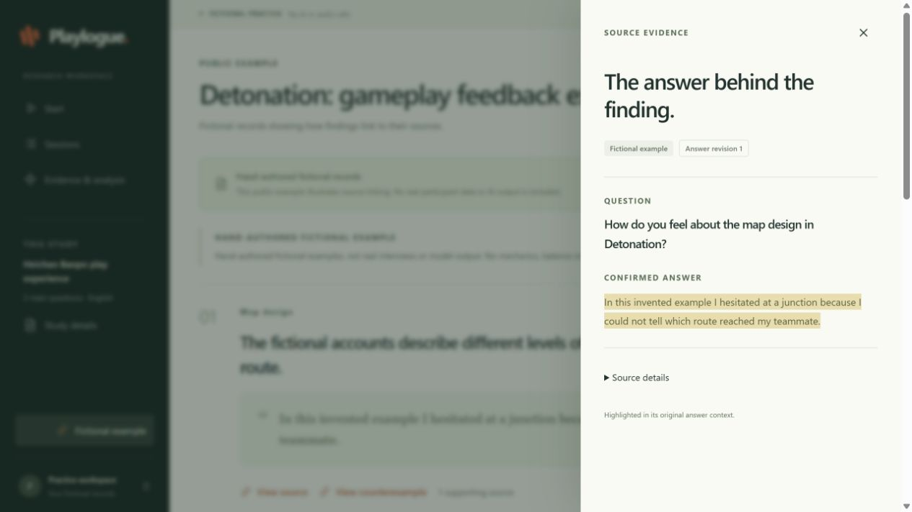
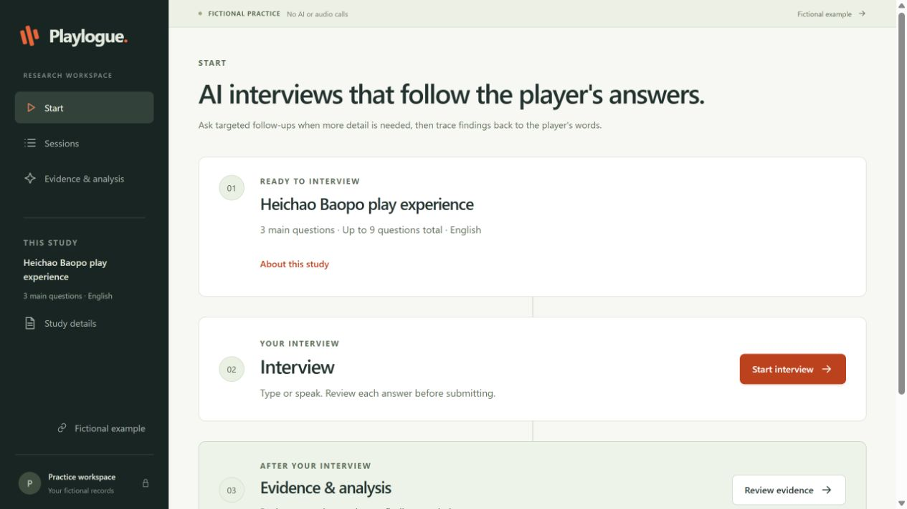
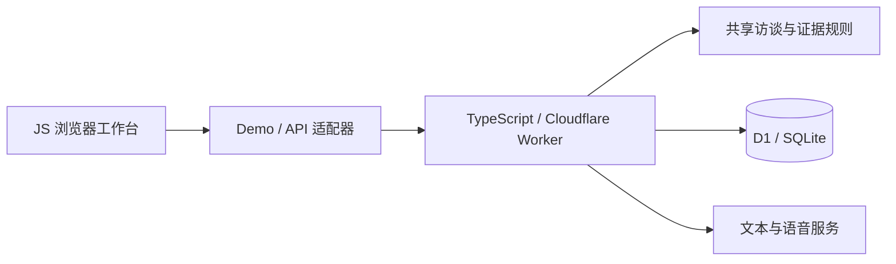

# Playlogue

[English](README.md) · [简体中文](README.zh-CN.md)

**让游戏 UX 访谈中的每条发现，都能回到玩家原话。**

Playlogue 是连接玩家访谈与证据审阅的研究工作台原型。玩家逐题回答，研究员从候选结论回查实际提问、原文片段与回答版本，把整理反馈和核对来源放在同一条工作流里。

**引导式访谈 · 受控追问 · 原话溯源 · 文本与语音流程**



*本地实际界面，使用人工编写的虚构记录；截图不含真实参与者数据，也不代表模型产出的研究结果。*

## 核心体验

1. **准备研究**：选择内置玩法反馈提纲，或设置研究目标、问题和追问额度，发布自定义研究。
2. **逐题倾听**：玩家输入文字，或确认语音转写后提交；追问受已发布提纲的主题与问题预算约束。
3. **核对结论**：结合访谈记录、支持原话、反例与未知项，人工审阅候选发现。



## 设计亮点

| 设计 | 解决的问题 |
| --- | --- |
| 受控追问 | 当前内置玩法提纲覆盖地图设计、玩家感知的干员平衡、改装与购买经济：三个主问题，每个主题最多一个即时追问，全场最多两个。已保存提纲保留各自版本与额度。 |
| 结论引用原话 | 引用绑定问题/回答 ID、回答版本、UTF-16 字符区间和逐字原文，使用前校验原文与来源一致。 |
| 回答修改后旧证据失效 | 修改回答会推进回答版本与会话内容/证据版本；基于旧快照的分析变为过期，旧引用不能悄悄沿用到新答案。 |
| 明确的文本/语音交互 | 语音流程包含问题播报、录音、转写及提交前确认；模式切换与中断任务由会话状态管理。 |

本地练习使用较早的虚构提纲，保留独立额度，并关闭 AI/音频调用。托管语音路径需要服务配置，且调用窗口须未过期；合成测试不能证明真实麦克风、扬声器或连续语音验收通过。候选结论仍需人工判断。

## 架构与技术栈



| 层次 | 实现 |
| --- | --- |
| 界面 | JavaScript ES modules、HTML/CSS；[client/](client/) 实现访谈、记录与证据视图 |
| 状态与证据 | [shared/](shared/) 中的 JavaScript 模块处理路由、追问预算、修订和引用校验 |
| API 与持久化 | TypeScript Worker、D1 repository；Drizzle ORM 定义 schema 并生成 SQLite 迁移，见 [server/](server/)、[db/](db/)、[drizzle/](drizzle/) |
| 构建与验证 | esbuild 打包 Worker，TypeScript 类型检查与 Node 内置测试运行器验证合成工作流 |

## 本地运行

使用 **Node.js 24+**，API 测试 harness 使用内置 SQLite。

```sh
npm ci
npm start
```

打开 **http://127.0.0.1:4174**，无需 API key 即可查看虚构练习与引用示例。示例用于体验界面，不是在线访谈服务。

```sh
npm run check
npm run build
npm run typecheck
npm run test:synthetic
```

构建后运行 `npm run preview:worker`，再打开 `http://127.0.0.1:4175/?adapter=api` 可预览 Worker/API；它使用全新合成 SQLite 数据库，关闭真实调用与可信身份。

## 继续了解

- [完整虚构证据示例截图](docs/images/evidence.png)
- [运行配置与验证边界](docs/DEVELOPMENT.zh-CN.md) · [English](docs/DEVELOPMENT.md)
- [截图来源说明](docs/SCREENSHOTS.md)

本仓库展示工程原型。托管使用需要私人运行配置；此处不宣称公开 Demo 或已部署服务。
